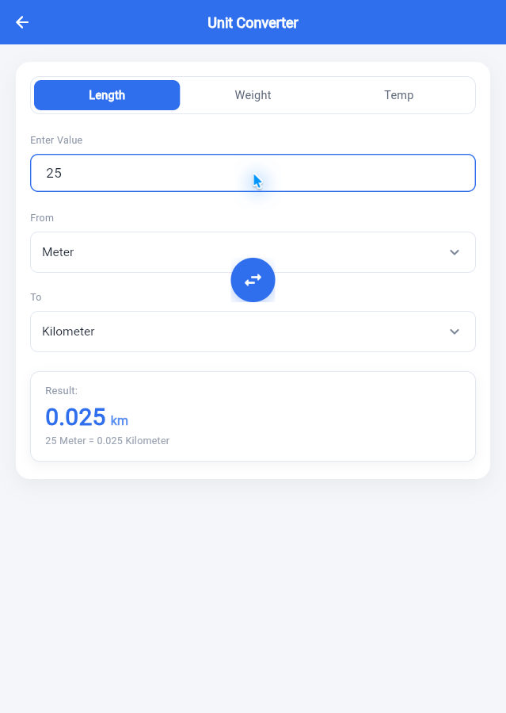

# Unit-Converter-App-in-Flutter

A clean, real-time **Unit Converter** built with Flutter and `Provider` state management.

Convert **Length**, **Weight** and **Temperature** units with live results, quick unit swapping and a
polished Material 3 interface.



## Features

- **Three categories** — Length, Weight and Temperature, switchable from a segmented tab bar.
- **18 units** — meter to inch, kilogram to pound, Celsius to Kelvin.
- **Real-time conversion** — the result updates on every keystroke, no button required.
- **Swap button** — exchanges the source and target unit in one tap.
- **Provider state management** — a single `ChangeNotifierProvider` drives the whole screen.
- **Clean UI** — Material 3, blue app bar, rounded cards and a soft neutral background.

## Supported Units

| Category | Units |
|---|---|
| Length | Meter, Kilometer, Centimeter, Millimeter, Mile, Yard, Foot, Inch |
| Weight | Kilogram, Gram, Milligram, Pound, Ounce, Stone, Metric Ton |
| Temperature | Celsius, Fahrenheit, Kelvin |

## Tech Stack

- **Flutter** 3.47 · **Dart** 3.13
- [`provider`](https://pub.dev/packages/provider) `^6.1.5+1` for state management
- Material 3 design system

## Project Structure

```
lib/
├── main.dart                      # Entry point
├── app.dart                       # MaterialApp + Provider wiring
├── data/
│   └── unit_catalog.dart          # All categories and units in one place
├── models/
│   ├── unit.dart                  # Unit with factor/offset conversion maths
│   └── conversion_category.dart   # A group of interchangeable units
├── providers/
│   └── converter_provider.dart    # ChangeNotifier holding the conversion state
├── screens/
│   └── converter_screen.dart      # Main screen
├── theme/
│   └── app_theme.dart             # Colours, spacing and app theme
├── utils/
│   └── formatters.dart            # Number formatting for the result
└── widgets/
    ├── category_tab_bar.dart       # Length / Weight / Temp tabs
    ├── unit_dropdown_field.dart    # From & To unit pickers
    ├── swap_button.dart            # Round swap button
    └── result_card.dart            # Live result card
```

### How the conversion works

Every unit is stored as a multiplier and an optional offset against its category base unit:

```text
baseValue = value * factor + offset
```

Scale-based units (meter, gram, …) only need a `factor`, while temperature uses an `offset` as
well because Fahrenheit and Kelvin do not start at zero like Celsius. One formula therefore handles
all three categories.

## Getting Started

```bash
flutter pub get
flutter run
```

Build a release bundle:

```bash
flutter build apk --release     # Android
flutter build web --release      # Web
```

## Tests

```bash
flutter test
```

The suite covers the conversion maths for all three categories, the swap behaviour, category
switching and the live result rendering in the widget tree.

```bash
flutter analyze
```
